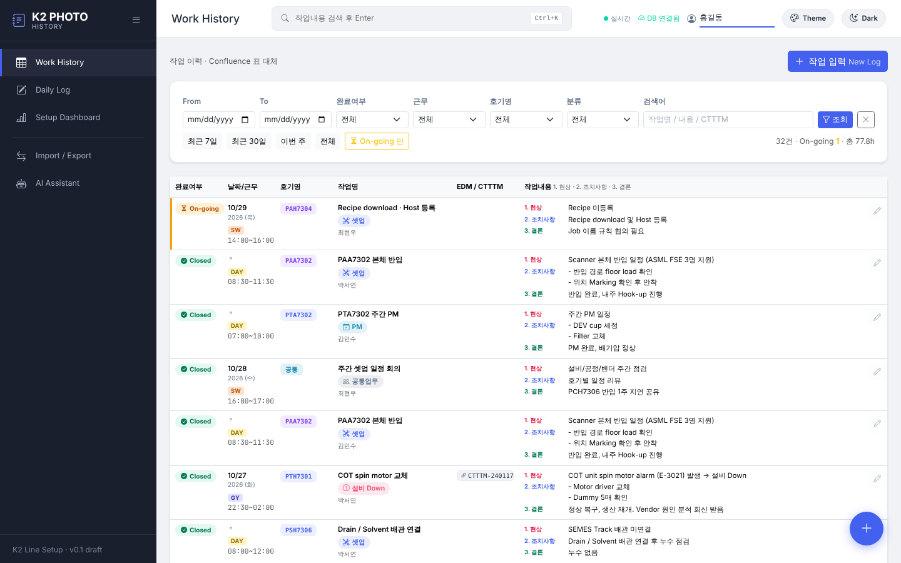
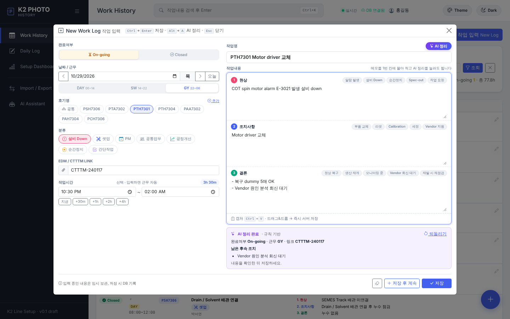
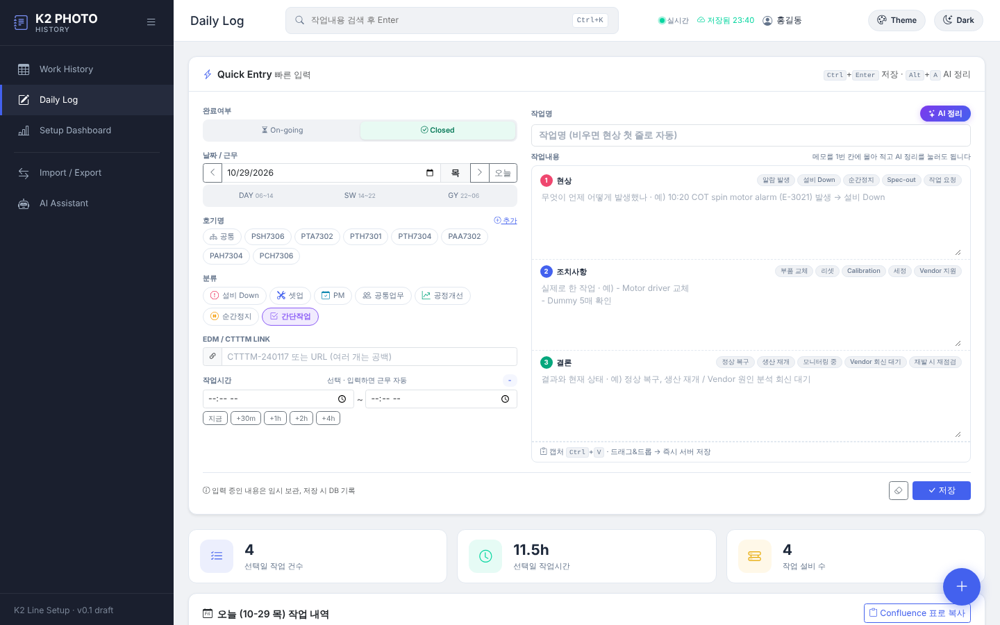
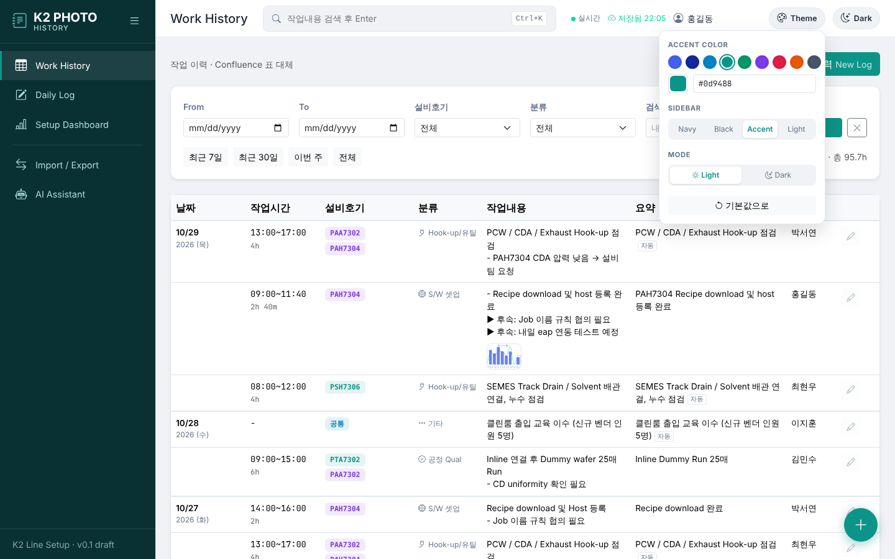
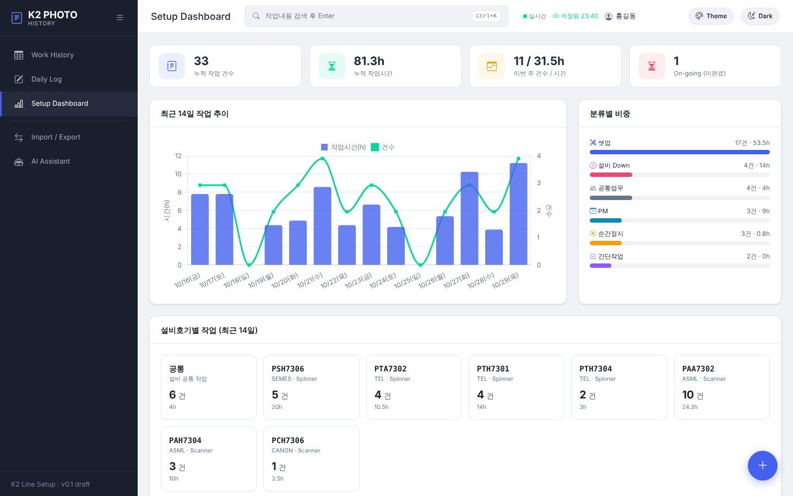
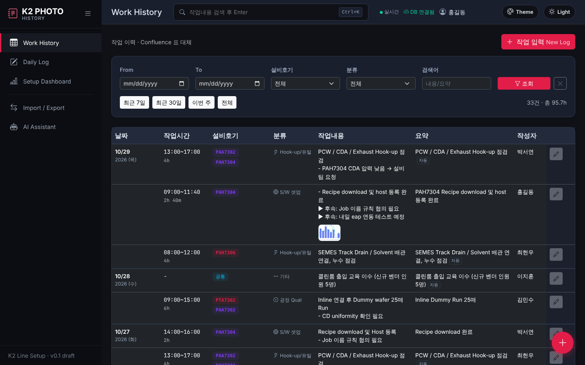

# K2 PHOTO History

K2 라인 셋업 기간의 **일일 작업내용을 간단히 입력 → DB 자동 저장 → AI 활용**하기 위한 대시보드입니다.
Confluence 페이지 표(날짜 / 작업시간 / 설비호기·공통 / 작업내용 / 요약)로 관리하던 방식을 대체합니다.

디자인은 `equip-history`(EquipBoard) 의 사이드바·KPI 카드·작업유형 버튼 스타일을, 구조와 설비 호기 명명 규칙은 `fdc-dashboard`(Flask + sqlite3) 를 따릅니다.

## 화면

▶ **데모 영상 (약 2분)**: [`docs/demo/k2photo_demo.mp4`](docs/demo/k2photo_demo.mp4) — 팝업 입력 · 캡처 붙여넣기 · AI 정리 · 수정 · 검색 · 실시간 반영 · Daily Log · Dashboard · Confluence 가져오기 · 테마 변경
▶ **데모 PNG**: 단계별 화면 [`docs/demo/png/`](docs/demo/png) · 한 장 요약 [`docs/demo/k2photo_demo_overview.png`](docs/demo/k2photo_demo_overview.png)
(영상·PNG 다시 만들기: 서버 실행 후 `node docs/demo/record_demo.js`, Playwright 필요)

| Work History (Confluence 표 대체) | New Work Log 팝업 (캡처 + AI 정리) |
|---|---|
|  |  |
| **Daily Log (컴팩트 입력)** | **Theme 패널 (Accent / Sidebar / Mode)** |
|  |  |
| **Setup Dashboard** | **Dark + Rose 테마** |
|  |  |

## 기능

메뉴: **Work History**(기본 화면) · **Daily Log** · **Setup Dashboard** · **Import / Export** · **AI Assistant**

### Confluence 작업이력 표와 같은 구성

| 완료여부 | 날짜 / 근무 | 호기명 | 작업명 | EDM / CTTTM LINK | 작업내용 |
|---|---|---|---|---|---|
| On-going / Closed | 날짜 + DAY(06~14) · SW(14~22) · GY(22~06) | 복수 선택 또는 `공통` | 비우면 자동 | 번호·URL 여러 개 | **1. 현상 / 2. 조치사항 / 3. 결론** |

- 분류(설비 Down · 셋업 · PM · 공통업무 · 공정개선 · 순간정지 · 간단작업)와 작업시간(선택, 입력하면 근무 자동 판정)도 함께 기록
- **작업내용 3칸이 미리 구성**되어 있고, 칸마다 빠른 문구 버튼(예: 결론의 `정상 복구` → Closed, `Vendor 회신 대기` → On-going 자동)
- 칸 높이는 내용에 맞춰 자동으로 늘어남
- Work History 표는 작업내용 칸을 넓게 두고 현상/조치/결론을 나눠 표시. 완료여부 배지 클릭으로 On-going ↔ Closed 전환, On-going 은 좌측 주황 표시
- 필터: 기간 · 완료여부 · 근무 · 호기 · 분류 · 검색어(작업명/내용/CTTTM), `On-going 만` 버튼

### 입력
- **작업 입력 팝업**: Work History 의 `작업 입력` 버튼, 우하단 `+`, 또는 `N` 키. 이력의 ✏️ 수정도 같은 팝업
  - `저장`(닫기) / `저장 후 계속`(연속 입력), 수정 시 `삭제`. Daily Log 화면과 같은 폼이라 임시보관·단축키 동일 (`Ctrl+Enter` 저장)
- **AI 정리** (`✨ AI 정리` 또는 `Alt+A`): 1. 현상 칸에 메모를 대충 몰아 적으면 작업명 · 현상/조치사항/결론 · 완료여부 · 근무 · 호기 · 분류 · EDM/CTTTM 을 자동 기입. `되돌리기` 지원
- **캡처 붙여넣기**: 작업내용에서 `Ctrl+V` (또는 드래그&드롭) → 즉시 서버 업로드. 수정 중인 기록이면 그 기록에 바로 저장
- **실시간 반영**: 5초마다 변경 확인, 다른 사람이 입력한 기록 자동 표시

### 가져오기 / 내보내기
- **Confluence 표 가져오기**: 표를 머리글까지 복사해 붙여넣으면 HTML 표로 읽어 셀 안 줄바꿈·병합 셀까지 복원. 머리글로 열 자동 판단, 작업내용의 1/2/3 자동 분리.
  이전 형식(날짜 | 작업시간 | 설비호기 | 작업내용 | 요약)도 지원
- **내보내기**: CSV(Excel) / JSONL(AI·RAG용, 현상·조치·결론 필드 포함) / Confluence wiki markup 표 — 모두 위와 같은 열 순서
- **테마**: 상단 `Theme` → Accent 9색 + 직접 선택, Sidebar 4종, Light/Dark (`static/js/theme.js`)

### 기존 데이터
서버 시작 시 이전 버전 DB(내용 + 요약)를 자동 변환: 요약 → 작업명, 내용 → 1. 현상 (이미 `1. 현상 / 2. 조치사항 / 3. 결론` 형식이면 칸별로 분리),
작업시간 → 근무, 완료여부는 Closed.

## 실행

```bash
pip install -r requirements.txt
python seed_data.py   # (선택) 최근 14일 데모 데이터 — work_logs 를 비우고 다시 채움
python app.py         # http://localhost:5070
```

- DB: `k2photo_history.db` (SQLite, 환경변수 `K2PH_DB` 로 경로 변경)
- 포트: 환경변수 `PORT` (기본 5070)
- 캡처 저장 경로: 환경변수 `K2PH_UPLOADS` (기본 `./uploads`)

### AI 정리 (LLM) 설정

photo-ai-bot / equip-history 와 같은 OpenAI 호환 설정을 사용합니다. 설정이 없으면 **규칙 기반**(호기명·시간·분류 키워드 인식)으로 동작하고,
LLM 호출이 실패해도 규칙 기반으로 자동 폴백합니다.

```bash
export LLM_API_URL=https://api.x.ai/v1      # 사내 게이트웨이 주소로 교체 가능 (/chat/completions 는 자동 부착)
export LLM_API_KEY=<key>                    # 키가 필요 없는 사내 서버면 생략
export LLM_MODEL=grok-4-fast-non-reasoning  # 선택
```
- Bootstrap / Bootstrap Icons / Chart.js 는 `static/vendor/` 에 포함 → 사내망(CDN 차단)에서도 동작

## API

| Method | Path | 설명 |
|---|---|---|
| GET | `/api/meta` | 설비호기·분류·작성자 목록 |
| POST | `/api/equipment` | 호기 추가 `{"name": "PAA7308"}` |
| GET | `/api/logs` | 조회 (`date_from`, `date_to`, `status`, `shift`, `equipment`, `category`, `author`, `q`, `limit`) |
| POST | `/api/logs` | 등록 |
| PUT / DELETE | `/api/logs/<id>` | 수정 / 삭제 |
| GET | `/api/stats` | 현황 집계 |
| POST | `/api/attachments` | 캡처 업로드 (multipart `file`, 선택 `log_id`) |
| DELETE | `/api/attachments/<id>` | 캡처 삭제 |
| POST | `/api/ai/organize` | AI 정리 (`title`, `symptom`, `action`, `result`, `equipment`, `category`, `start_time`) |
| GET | `/api/version` | 실시간 갱신용 변경 감지 |
| POST | `/api/import` | Confluence 표 가져오기 (`rows` 2차원 배열 또는 탭 구분 `text`, `dry_run` 지원) |
| GET | `/api/export.csv`, `/api/export.jsonl`, `/api/export/confluence` | 내보내기 (조회와 같은 필터) |

## AI 활용 계획

1. ~~AI 정리 버튼~~ (완료, `llm.py`) → 캡처 이미지까지 읽는 비전 모델 연동
2. 기간·호기별 주간 셋업 리포트 자동 생성
3. `/api/export.jsonl` 의 `text` 필드를 photo-ai-bot RAG 인덱스 소스로 연결

## 테스트

```bash
pip install -r requirements-dev.txt
pytest -q
```
