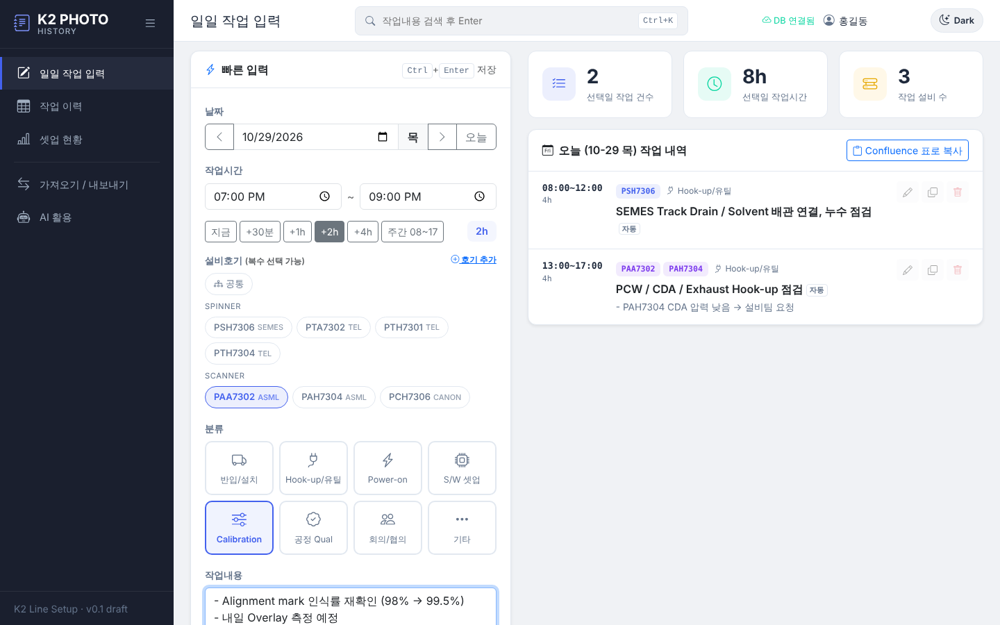
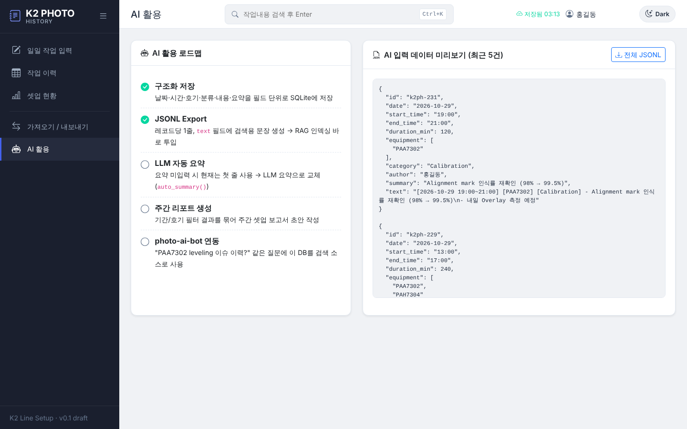

# K2 PHOTO History

K2 라인 셋업 기간의 **일일 작업내용을 간단히 입력 → DB 자동 저장 → AI 활용**하기 위한 대시보드입니다.
Confluence 페이지 표(날짜 / 작업시간 / 설비호기·공통 / 작업내용 / 요약)로 관리하던 방식을 대체합니다.

디자인은 `equip-history`(EquipBoard) 의 사이드바·KPI 카드·작업유형 버튼 스타일을, 구조와 설비 호기 명명 규칙은 `fdc-dashboard`(Flask + sqlite3) 를 따릅니다.

## 화면

| 일일 작업 입력 | 작업 이력 (Confluence 표 대체) |
|---|---|
|  |  |
| **셋업 현황** | **AI 활용 (JSONL 미리보기)** |
|  |  |

## 기능

- **빠른 입력**: 날짜(◀ ▶ / 오늘), 작업시간(지금·+30분·+1h·+2h·+4h·주간 프리셋, 소요시간 자동 계산·야간 자정 넘김 지원),
  설비호기 칩 다중 선택 또는 `공통`, 셋업 분류(반입/설치, Hook-up/유틸, Power-on, S/W, Calibration, 공정 Qual, 회의, 기타), 작업내용, 요약
  - `Ctrl+Enter` 저장, 저장 후 다음 작업 시작시간 = 직전 종료시간
  - 요약을 비우면 작업내용 첫 줄로 자동 요약 (`자동` 태그) → 추후 LLM 요약으로 교체 예정
  - 입력 중 내용은 브라우저에 임시 보관 (새로고침해도 유지)
- **작업 이력**: 날짜별 묶음 표, 기간/호기/분류/검색어 필터, 검색어 하이라이트, 수정·삭제
- **셋업 현황**: 누적/이번 주 건수·시간, 최근 14일 추이, 분류별 비중, 호기별 작업량 (클릭 시 이력 필터)
- **가져오기**: Confluence 표를 복사(탭 구분)해서 붙여넣으면 미리보기 후 일괄 등록 (병합된 날짜 셀은 윗 행 날짜 상속)
- **내보내기**: CSV(Excel, BOM 포함) / JSONL(AI·RAG용) / Confluence wiki markup 표 복사
- 다크 모드, 사이드바 접기, `Ctrl+K` 검색

## 실행

```bash
pip install -r requirements.txt
python seed_data.py   # (선택) 최근 14일 데모 데이터 — work_logs 를 비우고 다시 채움
python app.py         # http://localhost:5070
```

- DB: `k2photo_history.db` (SQLite, 환경변수 `K2PH_DB` 로 경로 변경)
- 포트: 환경변수 `PORT` (기본 5070)
- Bootstrap / Bootstrap Icons / Chart.js 는 `static/vendor/` 에 포함 → 사내망(CDN 차단)에서도 동작

## API

| Method | Path | 설명 |
|---|---|---|
| GET | `/api/meta` | 설비호기·분류·작성자 목록 |
| POST | `/api/equipment` | 호기 추가 `{"name": "PAA7308"}` |
| GET | `/api/logs` | 조회 (`date_from`, `date_to`, `equipment`, `category`, `author`, `q`, `limit`) |
| POST | `/api/logs` | 등록 |
| PUT / DELETE | `/api/logs/<id>` | 수정 / 삭제 |
| GET | `/api/stats` | 현황 집계 |
| POST | `/api/import` | Confluence 표 붙여넣기 가져오기 (`dry_run` 지원) |
| GET | `/api/export.csv`, `/api/export.jsonl`, `/api/export/confluence` | 내보내기 (조회와 같은 필터) |

## AI 활용 계획

1. `auto_summary()` 를 LLM 요약으로 교체 (photo-ai-bot / equip-history 의 LLM 클라이언트 재사용)
2. 기간·호기별 주간 셋업 리포트 자동 생성
3. `/api/export.jsonl` 의 `text` 필드를 photo-ai-bot RAG 인덱스 소스로 연결

## 테스트

```bash
pip install -r requirements-dev.txt
pytest -q
```
